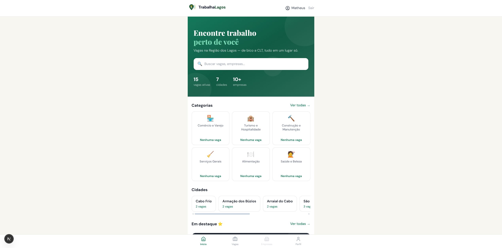

# TrabalhaLagos

**Português (Brasil)** · [English](#english)

## Português

O **TrabalhaLagos** conecta candidatos e empregadores da Região dos Lagos, no Rio de Janeiro. A plataforma reúne vagas locais e permite buscas por cidade, categoria e distância.

### Funcionalidades

- Busca de vagas por cidade, categoria e raio geográfico.
- Cadastro e perfil para candidatos e empregadores.
- Publicação e gerenciamento de vagas em um painel para empresas.
- Experiência mobile-first com recursos de PWA.

### Capturas de tela

As capturas da aplicação estão disponíveis na pasta [`public/screenshots`](public/screenshots/).

### Tecnologias

- **Frontend:** Next.js 15, React 19, TypeScript e Tailwind CSS 4.
- **API:** NestJS, TypeScript e Drizzle ORM.
- **Dados e infraestrutura:** PostgreSQL com PostGIS, Redis e BullMQ.
- **Gerenciador de pacotes:** pnpm.

### Executar localmente

Requisitos: Node.js, pnpm e Docker com Docker Compose.

1. Instale as dependências:

   ```bash
   pnpm install
   ```

2. Crie os arquivos de ambiente a partir dos exemplos:

   ```bash
   cp apps/api/.env.sample apps/api/.env.dev
   cp apps/client/.env.example apps/client/.env.local
   ```

3. Preencha `apps/api/.env.dev` com as configurações locais do PostgreSQL, Redis e JWT. Os valores padrão da API usam a porta `3004`; o client aponta para `http://localhost:3004/api/v1`.

4. Inicie PostgreSQL e Redis:

   ```bash
   pnpm dev:infra
   ```

5. Inicie API e client:

   ```bash
   pnpm dev
   ```

A aplicação web fica disponível em `http://localhost:3000` e a API em `http://localhost:3004`.

Para iniciar cada app separadamente, use `pnpm dev:api` ou `pnpm dev:client`.

### Validação

```bash
pnpm --filter @trabalha-lagos/api test:unit
pnpm --filter @trabalha-lagos/api build
pnpm --filter @trabalha-lagos/client lint
pnpm --filter @trabalha-lagos/client build
```

## English

**TrabalhaLagos** connects job seekers and employers across the Região dos Lagos area in Rio de Janeiro, Brazil. The platform brings local job listings together and supports searches by city, category, and distance.

### Features

- Search jobs by city, category, and geographic radius.
- Profiles and sign-up flows for job seekers and employers.
- An employer dashboard to publish and manage job listings.
- A mobile-first experience with PWA features.

### Screenshots

Application screenshots are available in the [`public/screenshots`](public/screenshots/) folder.

### Tech stack

- **Frontend:** Next.js 15, React 19, TypeScript, and Tailwind CSS 4.
- **API:** NestJS, TypeScript, and Drizzle ORM.
- **Data and infrastructure:** PostgreSQL with PostGIS, Redis, and BullMQ.
- **Package manager:** pnpm.

### Run locally

Requirements: Node.js, pnpm, and Docker with Docker Compose.

1. Install dependencies:

   ```bash
   pnpm install
   ```

2. Create local environment files from the examples:

   ```bash
   cp apps/api/.env.sample apps/api/.env.dev
   cp apps/client/.env.example apps/client/.env.local
   ```

3. Set local PostgreSQL, Redis, and JWT values in `apps/api/.env.dev`. The API defaults to port `3004`; the client points to `http://localhost:3004/api/v1`.

4. Start PostgreSQL and Redis:

   ```bash
   pnpm dev:infra
   ```

5. Start the API and web client:

   ```bash
   pnpm dev
   ```

The web app is available at `http://localhost:3000`, and the API at `http://localhost:3004`.

To start either app separately, run `pnpm dev:api` or `pnpm dev:client`.

### Validation

```bash
pnpm --filter @trabalha-lagos/api test:unit
pnpm --filter @trabalha-lagos/api build
pnpm --filter @trabalha-lagos/client lint
pnpm --filter @trabalha-lagos/client build
```
